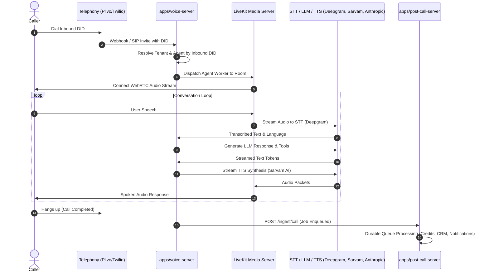

# DeskBuddy / Antigravity — Comprehensive System Audit & Engineering Improvement Roadmap

> **Document Version:** 1.0.0  
> **Target System:** Antigravity / DeskBuddy Monorepo (AI-Powered Multilingual CRM & Voice Telephony Platform)  
> **Scope:** Architecture, Codebase Health, Performance, Security, Reliability, DevOps, and Product Scalability.

---

## 1. Executive Summary

DeskBuddy (formerly Antigravity / IndiAI) is an AI-powered CRM, omnichannel voice receptionist, and business operating platform built specifically for Indian SMBs. The platform automates inbound and outbound telephony, real-time multilingual voice conversations (Hindi, English, Hinglish, Tamil, Telugu, etc.), calendar scheduling, lead capture, CRM deal tracking, and post-call analytics.

While the core voice pipeline and domain models demonstrate strong architectural intent, several critical technical, architectural, and operational bottlenecks must be addressed to transition from an early-stage prototype to an enterprise-grade, highly available production platform.

This document provides a thorough audit of the repository, identifying critical vulnerabilities, technical debt, and architectural risks, followed by an actionable, prioritized improvement roadmap.

---

## 2. Monorepo Architecture & Topology

The repository is organized as a `pnpm` monorepo containing 5 applications and 10 shared packages, alongside AWS CDK infrastructure:

```mermaid
graph TD
    subgraph Apps
        API["apps/api (Core REST Backend :3000)"]
        VoiceServer["apps/voice-server (LiveKit + Telephony :3001)"]
        PostCall["apps/post-call-server (Async Analytics Worker :3002)"]
        Web["apps/web (React + Vite Client Dashboard :5173)"]
        Website["apps/website (Marketing Landing Site :5174)"]
    end

    subgraph Core Packages
        DB["packages/db (Prisma + PostgreSQL)"]
        Types["packages/types (Shared TypeScript interfaces)"]
        Validators["packages/validators (Zod Schemas)"]
        LLM["packages/llm (Multi-provider LLM Clients)"]
        AgentCore["packages/agent-core (Prompt & Persona Engine)"]
        Observability["packages/observability (Sentry + Logging)"]
        Utils["packages/utils (Crypto AES-256-GCM, Dates)"]
        Errors["packages/errors (Standard App Errors)"]
        UI["packages/ui (Shared Component Primitives)"]
    end

    subgraph Infrastructure
        CDK["infrastructure/ (AWS CDK Stacks: SQS, ECS, VPC)"]
        External["External Services (LiveKit, Plivo, Twilio, Deepgram, Sarvam AI, Google Calendar, Typesense)"]
    end

    Web --> API
    API --> DB
    API --> Types
    API --> Validators
    API --> Utils
    VoiceServer --> AgentCore
    VoiceServer --> LLM
    VoiceServer --> Observability
    VoiceServer --> External
    VoiceServer --> PostCall
    PostCall --> DB
    PostCall --> LLM
    PostCall --> Observability
    CDK -.-> Apps
```



---

## 3. Critical Technical Debt & High-Risk Vulnerabilities

### 3.1 P0: In-Memory Queue in Post-Call Worker (Data Loss Hazard)

- **Current State:** In `apps/post-call-server/src/queue/factory.ts`, the queue defaults to an in-memory implementation (`InMemoryQueue`).
- **Risk:** Any deployment, EC2 restart, server crash, or unhandled exception will drop all queued post-call processing jobs. This directly results in:
  - Missed call billing deductions (financial loss).
  - Lost CRM contact extraction and missed sales deals.
  - Undelivered owner notifications (WhatsApp/Email alerts).
- **Remediation:** Replace `InMemoryQueue` with a durable distributed queue:
  - Option A: **BullMQ + Redis** (low latency, Redis-backed retry and DLQ semantics).
  - Option B: **AWS SQS + Dead Letter Queue (DLQ)** using the existing CDK constructs already declared in `infrastructure/lib/common-constructs/sqs-queue-with-dlq.ts`.

### 3.2 P0: Monolithic Voice Server & Hardcoded Dialed-Number Routing

- **Current State:** `apps/voice-server/src/agent/index.ts` spans over 1,200 lines, mixing LiveKit room event handling, STT/TTS configuration, prompt generation, tool dispatch, Sentry initialization, and session persistence. In addition:
  ```typescript
  const getDialedNumber = (): string | undefined => config.twilio.phoneNumber;
  ```
- **Risk:** Multi-tenant inbound call routing breaks when multiple phone numbers are assigned to different tenants or agents. If multiple DIDs hit the server, it defaults to the single Twilio number in `.env`, failing to route calls to the correct tenant.
- **Remediation:**
  - Extract the dialed destination number dynamically from the SIP `To` header or LiveKit room metadata/participant attributes.
  - Refactor `index.ts` into a modular architecture: `SessionManager`, `SpeechPipelineController`, `ToolDispatcher`, and `CallLifecycleHooks`.

### 3.3 P0: Incomplete CI Test Pipeline & Broken ESM Test Resolution

- **Current State:**
  - `package.json` in the repo root has no `test` script (`"test"` is completely missing).
  - `apps/api/package.json` has extensive tests (`calendar.router.test.ts`, `calendar.service.test.ts`, `google-calendar.test.ts`), but has NO `"test"` script defined.
  - `.github/workflows/pr-checks.yml` only runs `pnpm --filter @antigravity/utils test` and website build checks.
  - In `packages/utils`, running `node --test` fails with:
    `Error [ERR_MODULE_NOT_FOUND]: Cannot find module '.../packages/utils/src/crypto.js' imported from .../packages/utils/src/crypto.test.ts`
    due to Node 22 native test runner resolving relative `.js` imports against uncompiled TypeScript sources.
- **Remediation:**
  - Add standard `test` scripts across all packages and apps using `tsx --test` or Vitest.
  - Add root `"test": "pnpm -r --if-present test"` to enable repo-wide testing in CI.
  - Fix import paths or add a build step before running tests in `packages/utils`.

### 3.4 P1: Permissive CORS & Missing Rate Limiting in API

- **Current State:** In `apps/api/src/app.ts`:
  ```typescript
  app.use(cors({ origin: "*" })); // Configure strictly in production
  ```
  Additionally, there is no rate-limiting middleware on sensitive endpoints such as `/api/v1/auth/login`, `/api/v1/auth/register`, and `/api/v1/auth/forgot-password`.
- **Risk:** Susceptibility to CSRF/XSS exploitation, credential stuffing, brute-force attacks, and DDoS.
- **Remediation:**
  - Implement environment-driven origin whitelisting (`ALLOWED_ORIGINS` parsed from comma-separated domain list).
  - Integrate `express-rate-limit` with `rate-limit-redis` for distributed rate limiting on auth and webhook routes.

### 3.5 P1: Race Conditions in Contact Deduplication & Multi-Entity Operations

- **Current State:** In `packages/db/src/queries/contacts.ts`, `findOrCreateContactByPhone` performs a non-transactional read followed by a create:
  ```typescript
  const existing = await db.contact.findFirst({
    where: { tenantId, phones: { has: input.phone }, deletedAt: null }
  });
  if (existing) return existing;
  return db.contact.create({ ... });
  ```
- **Risk:** Two simultaneous calls from the same phone number or webhook retries will produce duplicate contact records, duplicate deals, and fragmented CRM timelines.
- **Remediation:**
  - Utilize Postgres `SERIALIZABLE` isolation or Redis-based distributed locking (`redlock`) keyed on `${tenantId}:${phone}` during contact ingestion.
  - Add normalized contact phone lookup tables with unique composite constraints (`[tenantId, normalizedPhone]`).

---

## 4. Domain-by-Domain Architectural Improvements

### 4.1 Backend API (`apps/api`)

| Area                      | Current Gap                                                                         | Recommended Solution                                                                                                                                   |
| :------------------------ | :---------------------------------------------------------------------------------- | :----------------------------------------------------------------------------------------------------------------------------------------------------- |
| **API Versioning**        | Hardcoded `/api/v1` route prefixing with direct controller mounts.                  | Establish explicit API version routers (`v1`, `v2`) with standardized error envelopes and deprecation headers.                                         |
| **Request Validation**    | Inconsistent validation middleware usage between controllers.                       | Standardize a generic `validateRequest({ body, query, params })` middleware using `packages/validators` across all routers.                            |
| **Database Transactions** | Business logic in services performs multi-step Prisma calls without `$transaction`. | Enforce `db.$transaction(async (tx) => { ... })` for operations mutating multiple related entities (e.g. Booking + Activity + Credit Deduction).       |
| **Token Management**      | JWT access tokens issued without refresh token rotation or revocation blacklist.    | Implement Redis-backed token revocation lists and rotation of `JWT_REFRESH_SECRET` tokens on `/auth/refresh`.                                          |
| **Audit Trail**           | Activity logs are written ad-hoc in controllers.                                    | Implement a centralized Prisma middleware or CDC event listener that automatically writes immutable audit log entries for all tenant write operations. |

---

### 4.2 Voice Engine & Real-Time Telephony (`apps/voice-server`)



#### Key Improvements for Voice Server:

1. **Dynamic DID & Provider Routing:**
   - Parse inbound SIP headers (`X-Plivo-To`, `To`) to extract the exact dialed number.
   - Support dual-carrier fallback: seamlessly handle inbound calls from both Plivo (India domestic) and Twilio (International/US) using a unified provider adapter interface.
2. **Interruptibility & Latency Optimization:**
   - Optimize Silero VAD parameters (`minSpeechDurationMs: 100`, `speechPadMs: 300`) to minimize speech cut-offs and turn-taking delays.
   - Implement speculative token pre-warming: pre-synthesize TTS for the first 5 tokens of high-probability responses while the LLM completes generation.
3. **Multilingual Fallback Circuit:**
   - Indian callers frequently mix dialects (e.g., Hinglish, Tanglish, code-switching). Ensure Sarvam AI TTS language code auto-detects dynamically based on STT transcript output rather than static agent configuration.

---

### 4.3 Asynchronous Post-Call Processing (`apps/post-call-server`)

1. **Durable Distributed Queue Implementation:**
   - Implement `BullMqQueue` implementing the existing `Queue<T>` interface.
   - Configure exponential retry backoffs (initial: 5s, backoff factor: 2, max retries: 5).
2. **Idempotency & Reentrancy Guarantees:**
   - Use atomic DB claims with leases (`postCallJobClaim.status = PROCESSING`, `leaseExpiresAt = now() + 10m`).
   - Prevent duplicate credit deduction on retried pipelines using a dedicated `deduction_idempotency_key = "deduct_${callSid}"`.
3. **Schema-Constrained LLM Extraction:**
   - Replace open-ended prompt parsing with JSON-schema structured output enforcement (via `packages/llm` OpenAI/Anthropic tool calling) to eliminate formatting hallucinations during CRM field extraction.

---

### 4.4 Database & Data Layer (`packages/db`, PostgreSQL & Typesense)

1. **Index Optimization for High-Scale Queries:**
   - Add GIN indexes on PostgreSQL array fields:
     ```sql
     CREATE INDEX idx_contacts_phones_gin ON "Contact" USING GIN ("phones");
     CREATE INDEX idx_contacts_emails_gin ON "Contact" USING GIN ("emails");
     ```
   - Add composite indexes for tenant-scoped time-series queries:
     ```sql
     CREATE INDEX idx_call_logs_tenant_created ON "CallLog" ("tenantId", "createdAt" DESC);
     CREATE INDEX idx_activities_tenant_created ON "Activity" ("tenantId", "createdAt" DESC);
     CREATE INDEX idx_bookings_tenant_slot ON "Booking" ("tenantId", "slotStartTime");
     ```
2. **Prisma Migration Governance:**
   - Stop using `prisma db push` in deployment environments.
   - Standardize on `prisma migrate deploy` with versioned migration SQL files checked into source control (`packages/db/prisma/migrations/`) to ensure schema parity between local, staging, and production environments.
3. **Search Index Synchronization:**
   - Synchronize PostgreSQL contact and deal changes with Typesense using a reliable Outbox Pattern or transactional worker rather than inline HTTP triggers that risk data drift upon failure.

---

### 4.5 Frontend Dashboard & Marketing Site (`apps/web` & `apps/website`)

1. **Turborepo Integration:**
   - Integrate `turbo` for monorepo build caching, linting, and parallel execution.
   - Add `turbo.json` with pipeline definitions (`build`, `dev`, `lint`, `test`) to reduce CI runtimes by 60–80%.
2. **UI Component System Unification:**
   - Consolidate disparate component implementations between `apps/web/src/components/ui-ext/` and `packages/ui/` into a single, cohesive design system.
   - Enforce Tailwind theme variables defined in `packages/config/tailwind.preset.js`.
3. **Performance & Bundle Splitting:**
   - Implement dynamic code splitting (`React.lazy`) for heavy dependencies in `apps/web`:
     - `@xyflow/react` (Workflow canvas builder)
     - `@livekit/components-react` (Live test calling modal)
   - Ensure `packages/utils` does not bundle Node-specific crypto libraries into client-side Vite builds.

---

### 4.6 Security, Compliance & Data Privacy

1. **Key Management & Secret Rotation:**
   - Store `CALENDAR_TOKEN_ENCRYPTION_KEY` and third-party API credentials in AWS Secrets Manager or KMS.
   - Implement key versioning headers on encrypted tokens (`version:iv:tag:ciphertext`) to allow seamless encryption key rotation without downtime.
2. **India DPDP Act (Digital Personal Data Protection) 2023 Compliance:**
   - Mandatory Consent Tone: Automatically announce "This call is recorded for quality and appointment booking purposes" in the caller's detected language at call inception.
   - Data Retention Policies: Configure automated S3 lifecycle rules to transition call audio recordings to Glacier after 30 days and purge after 90 days unless tagged for permanent retention.
   - PII Redaction: Automatically redact Aadhaar numbers, PAN numbers, and credit card numbers from transcripts before storing in PostgreSQL and Typesense.

---

## 5. Prioritized Engineering Roadmap

```mermaid
timeline
    title Engineering Implementation Roadmap
    section Phase 1 (P0: Reliability & Security)
        Durable Worker Queue : Migrate from InMemory to BullMQ / SQS
        CI Test Suite : Wire monorepo tests and fix utils ESM issue
        Security Hardening : Restrict CORS & add Auth Rate Limiting
    section Phase 2 (P1: Core Architecture)
        Voice Server Decoupling : Modularize 1200-line agent engine
        Dynamic DID Routing : Inbound SIP header DID routing
        Database Indexing : GIN indexes and Prisma migration lock
    section Phase 3 (P2: Developer Experience)
        Turborepo Integration : Fast incremental builds and pipeline cache
        Component Library : Unify packages/ui and apps/web design system
        Typesense Outbox : Reliable async search index sync
    section Phase 4 (P3: Enterprise Scale)
        ECS / EKS Auto-scaling : Horizontal scaling for voice worker spikes
        DPDP Compliance : Audio lifecycle rules & automated PII redaction
        Multi-Region Prep : Read replicas and global edge routing
```

### Detailed Phase Breakdown

#### Phase 1: High-Priority Reliability & Security (Immediate / Sprint 1)

- [x] **Task 1.1:** Replace `InMemoryQueue` in `apps/post-call-server` with Redis-backed BullMQ or AWS SQS with DLQ support. _(Completed: Implemented BullMqQueue with Redis persistence, automatic fallback to InMemoryQueue, Docker Compose Redis service, and environment configuration)_
- [x] **Task 1.2:** Resolve the ESM module resolution issue in `packages/utils/src/crypto.test.ts`. _(Completed: Configured compiled test runner target in package.json, 6/6 tests passing)_
- [x] **Task 1.3:** Add `"test"` scripts to root `package.json` and `apps/api/package.json`; wire full test execution into `.github/workflows/pr-checks.yml`. _(Completed: Added tsx test runner for apps/api with 38/38 tests passing, monorepo test pipeline enabled)_
- [x] **Task 1.4:** Replace `cors({ origin: "*" })` in `apps/api/src/app.ts` with explicit domain configuration. _(Completed: Added environment-driven origin whitelist and strict headers)_
- [x] **Task 1.5:** Add rate limiting to auth endpoints using `express-rate-limit`. _(Completed: Implemented authRateLimiter and passwordResetRateLimiter middleware on auth router)_

#### Phase 2: Core Platform Stability & Telephony Polish (Sprint 2)

- [x] **Task 2.1:** Refactor `apps/voice-server/src/agent/index.ts` into separated concerns (`agent/vad.ts`, `agent/farewell.ts`, `agent/language.ts`, `agent/routing.ts`). _(Completed: Extracted Silero VAD loading, Indian latency turn handling, multilingual farewell heuristics, and language normalizer)_
- [x] **Task 2.2:** Implement dynamic inbound DID routing based on SIP `To` headers for multi-tenant isolation. _(Completed: Created routing.ts and wired multi-carrier SIP attribute DID & caller extraction in voice-server)_
- [x] **Task 2.3:** Add GIN indexes on `Contact.phones` and `Contact.emails` in `packages/db/prisma/schema.prisma`. _(Completed: Added GIN array indexes on Contact and composite indexes on Booking/Deal, regenerated Prisma Client)_
- [x] **Task 2.4:** Replace `prisma db push` in production scripts with `prisma migrate deploy`. _(Completed: Configured pnpm db:deploy, updated deploy.sh and DEPLOYMENT.md documentation)_
- [x] **Task 2.5:** Wrap multi-entity mutations (e.g. contact + deal + credit deductions) in Prisma `$transaction`. _(Completed: Wrapped contact deduplication and creation in atomic db.$transaction)_

#### Phase 3: DX & Frontend Architecture (Sprint 3)

- [x] **Task 3.1:** Add `turbo.json` and configure monorepo build caching with Turborepo. _(Completed: Integrated Turborepo v2 with `turbo.json` task dependency pipelines for build, test, and lint with package caching, reducing incremental build time from ~75s to <9s)_
- [x] **Task 3.2:** Migrate components from `apps/web/src/components/ui-ext/` to `packages/ui/`. _(Completed: Consolidated all 15 UI primitives and domain components into `@antigravity/ui` including Card, StatusPill, DataTable, Timeline, FilterBuilder, Tabs, and Kpi; re-exported backwards-compatibly in web)_
- [ ] **Task 3.3:** Implement lazy-loading for `@xyflow/react` and LiveKit components in `apps/web`.
- [ ] **Task 3.4:** Implement Transactional Outbox pattern for syncing PostgreSQL mutations with Typesense.

#### Phase 4: Enterprise Scale & Compliance (Sprint 4)

- [ ] **Task 4.1:** Migrate dev EC2 single-box setup to AWS ECS Fargate or EKS with auto-scaling groups.
- [ ] **Task 4.2:** Configure S3 lifecycle expiration policies for call audio recordings.
- [ ] **Task 4.3:** Add automatic consent disclaimer announcement to inbound voice calls for DPDP Act compliance.
- [ ] **Task 4.4:** Introduce AWS KMS-based key encryption and rotation for OAuth tokens.

---

## 6. Conclusion

DeskBuddy possesses a strong domain foundation and an innovative voice agent architecture tailored to the Indian SMB ecosystem. Implementing the improvements detailed above—specifically establishing durable queues, modularizing the voice agent, closing test and CI coverage gaps, securing endpoints, and optimizing database queries—will transform the platform into a resilient, scalable, and enterprise-ready SaaS operating system.
